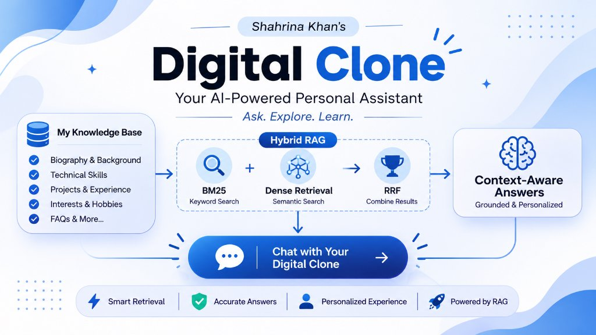
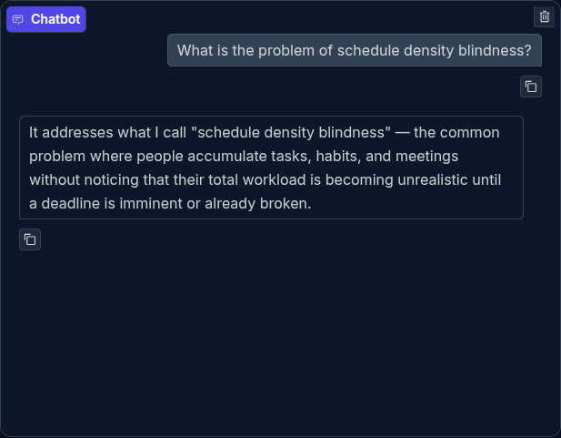
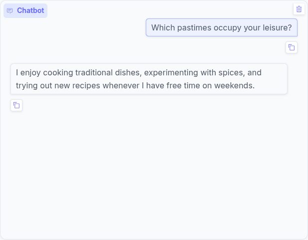
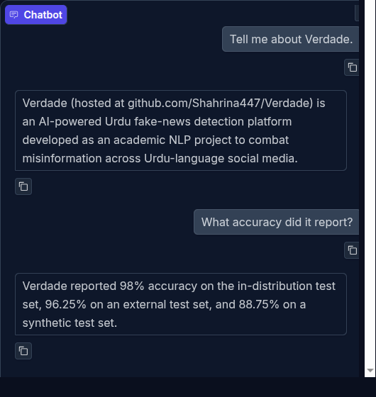

# 🤖 Shahrina Khan — AI Digital Clone

<p align="center">
  
</p>

> A first-person, document-grounded assistant built with hybrid Retrieval-Augmented Generation (RAG). Ask about my education, projects, technical interests, work habits, and goals.

| Live demo | Source code | Student |
|---|---|---|
| [Open the Hugging Face Space](https://huggingface.co/spaces/abdullaheqbal/digital-clone) | [GitHub repository](https://github.com/Shahrina447/My_Digital_clone) | Shahrina Khan · BS Computer Science, UMT Sialkot · 23018020084 |

**Important:** This is an AI clone, not the real person. Answers are generated from the documents in `data/`; the clone should say when its notes do not contain an answer.

## See it in action

| A specific project question | A paraphrased question with no shared answer words |
|---|---|
|  |  |

### Short conversation memory

The follow-up uses “it” after Verdade is introduced. The app keeps the latest two user/assistant turns for the LLM prompt. This screenshot was captured with the offline fallback, which answers from retrieved notes; API-backed generation also receives the recent turns as conversational context.



## Assignment Report

> **Submission deadline:** 10-November-2026
> **Deliverable 1 — Public Space:** [https://huggingface.co/spaces/abdullaheqbal/digital-clone](https://huggingface.co/spaces/abdullaheqbal/digital-clone)
> **Deliverable 2 — One-page report:** this README section below.

---

### 1. Knowledge Base and Rationale

The knowledge base contains **eight Markdown documents** (≈ 6,850 words):

| File | Content |
|---|---|
| `bio.md` | Personal background, education history, hobbies |
| `cv.md` | Academic and project experience |
| `projects.md` | Detailed project write-ups (DeadlineOS, Verdade, etc.) |
| `faq.md` | Frequently asked questions and direct answers |
| `opinions.md` | Personal opinions on tools, tech, and practices |
| `how_i_work.md` | Workflow, debugging strategy, work habits |
| `advice_to_juniors.md` | Advice Shahrina would give to junior students |
| `future_goals.md` | Academic and professional aspirations |

**Why this mix?**
Personal facts, school names, project titles, and exact terms (e.g. *“schedule density blindness”*) reward **BM25 keyword search**. Natural-language descriptions of habits, opinions, and paraphrased questions benefit from **dense semantic search**. Using both together via **Hybrid RRF** achieves the best overall coverage. Personal contact details and other sensitive information are excluded.

Documents are split into **34 overlapping chunks** (250 words, 50-word overlap), retaining each source name and chunk ID.

---

### 2. Five-Question Retrieval Comparison

Each cell shows the top-ranked chunk and its score for that retrieval mode. BM25, dense, and RRF scores use different scales — compare the result and rank, not the score magnitude.

| # | Test question | BM25 top result | Dense top result | Hybrid top result | Best mode and why |
|:-:|---|---|---|---|---|
| 1 | **What is the problem of `schedule density blindness`?** *(rare exact phrase)* | `faq_chunk_2` (10.330) | `projects_chunk_0` (0.340) | `faq_chunk_2` (0.033) | **BM25 / Hybrid** — the exact rare phrase retrieves the FAQ definition directly; dense finds only the project write-up. |
| 2 | **Which pastimes occupy your leisure?** *(paraphrase — zero shared words with the answer)* | `faq_chunk_0` (3.495) | `opinions_chunk_0` (0.287) | `bio_chunk_0` (0.031) | **Dense** — semantic matching surfaces the hobbies passage even though no question words appear in the answer text. |
| 3 | What accuracy did Verdade achieve during evaluation? | `faq_chunk_3` (12.521) | `faq_chunk_4` (0.608) | `faq_chunk_4` (0.033) | **Hybrid** — fuses the FAQ chunk (accuracy figure) with the project chunk (evaluation context) for the most complete answer. |
| 4 | Where did you complete school and college before UMT? | `faq_chunk_0` (17.105) | `bio_chunk_1` (0.417) | `faq_chunk_0` (0.033) | **BM25 / Hybrid** — institution names are distinctive keywords; BM25 finds the exact FAQ answer immediately. |
| 5 | What is your debugging strategy? | `faq_chunk_7` (8.334) | `how_i_work_chunk_1` (0.421) | `how_i_work_chunk_1` (0.032) | **Hybrid** — surfaces the detailed workflow passage; BM25 also finds the concise FAQ answer, giving a complete picture. |

**Hand-labeled Hit@3 evaluation** (`python tests/eval_hit3.py`, 15 queries):
**BM25 13/15 (86.7%)** · **Dense 13/15 (86.7%)** · **Hybrid 14/15 (93.3%)**
These are retrieval hits against labeled chunk IDs, not a measure of answer quality.

---

### 3. Failure Case

**Question:** *“What is DeadlineOS and what problem does it solve?”*

The offline extractive fallback returns only the short FAQ entry for “What is DeadlineOS?” — which describes the product but omits the specific *“schedule density blindness”* problem it was built to address. The fallback selects the single best-matching answer rather than combining evidence across multiple chunks to cover each part of a multi-part question.

**Why it happened:** The question has two clauses. The retriever ranks the chunk that answers the first clause highest, so the second clause’s answer (from a different chunk) is never surfaced in the generated response.

---

### 4. Next Improvement

**Clause-aware multi-part answering:**
Split multi-part questions into sub-questions automatically, retrieve evidence for each sub-question independently, and merge only the supported facts into one coherent answer. This would prevent a strong match on one clause from hiding an equally relevant fact from another clause.

---

## How it works

```text
Question
   ↓
Rule-based router ──→ BM25 / dense / Hybrid (RRF)
   ↓
Top-k source chunks ──→ grounded generation
                         Mistral → Hugging Face → extractive fallback
   ↓
Answer + source panel + three-mode retrieval comparison
```

- **Chunking:** 250-word sliding windows with 50-word overlap; source and chunk ID retained.
- **BM25:** Okapi BM25 keyword retrieval (`rank_bm25`).
- **Dense retrieval:** `sentence-transformers/all-MiniLM-L6-v2` embeddings (384 dimensions), stored in `embeddings.npy`.
- **Hybrid retrieval:** Reciprocal Rank Fusion (RRF), with `k = 60`.
- **Routing:** Personal facts favor BM25, opinion questions favor dense retrieval, general questions use Hybrid, and clearly out-of-scope requests are declined.
- **Grounding and privacy:** First-person persona, answers limited to retrieved notes, and no disclosure of private contact information.
- **Generation fallback:** Mistral API → Hugging Face Inference API → extractive notes fallback. The local screenshots show the offline fallback.
- **Conversation memory:** The latest two turns are appended to the prompt for API generation. The extractive offline fallback answers from retrieved notes and does not interpret history independently.
- **Gradio interface:** Retrieval-mode selector, top-k control, source chunk panel, comparison table, example questions, and a persistent AI-clone disclaimer.

## Optional extras

- **Agentic routing:** `classify_question()` and `route_mode()` in `src/engine.py`.
- **Short-term memory:** The generator includes up to four recent messages (two turns) in the API prompt.
- **Hand-labeled evaluation:** 15 queries with Hit@3 tracking by retrieval mode in `tests/eval_hit3.py`.

## Run locally

```bash
git clone https://github.com/Shahrina447/My_Digital_clone.git
cd My_Digital_clone
python3 -m venv .venv
source .venv/bin/activate
pip install -r requirements.txt
python app.py
```

Open `http://127.0.0.1:7860`. Embeddings and chunks are included. To enable hosted generation, configure `MISTRAL_API_KEY` and/or `HF_TOKEN` as local environment variables or Hugging Face Space secrets—never commit API keys.
